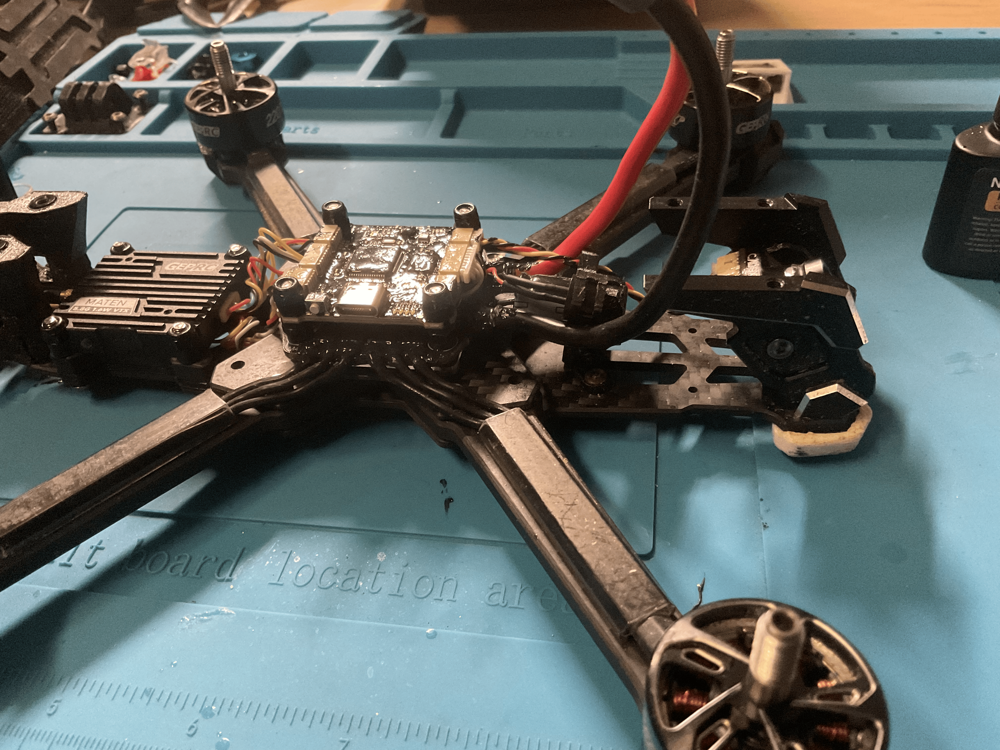
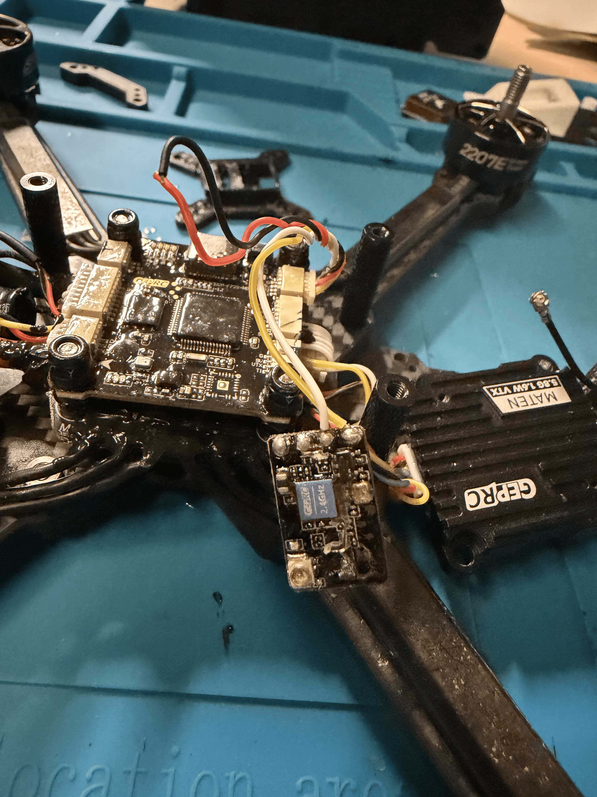
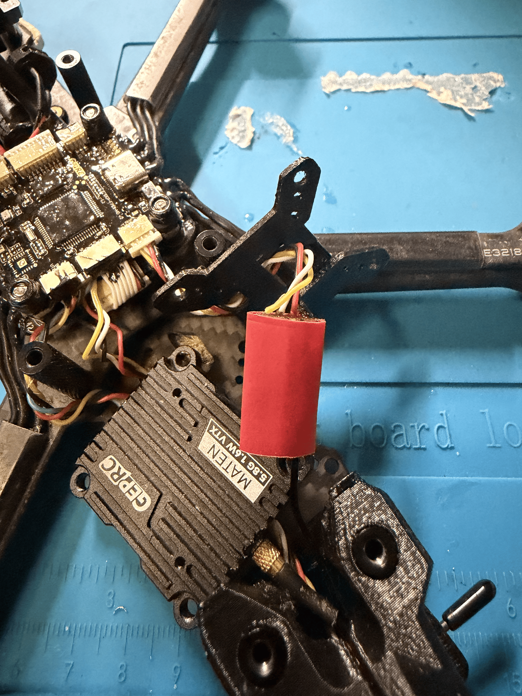
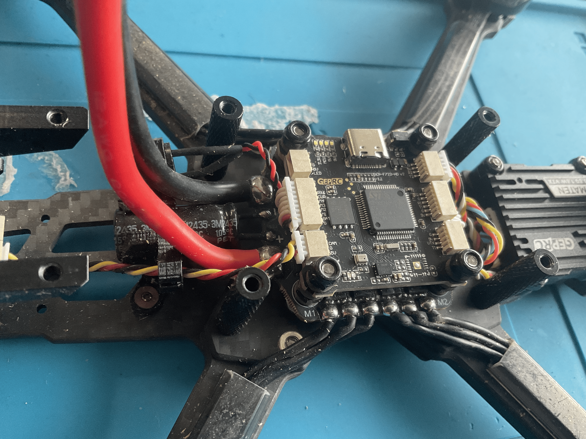
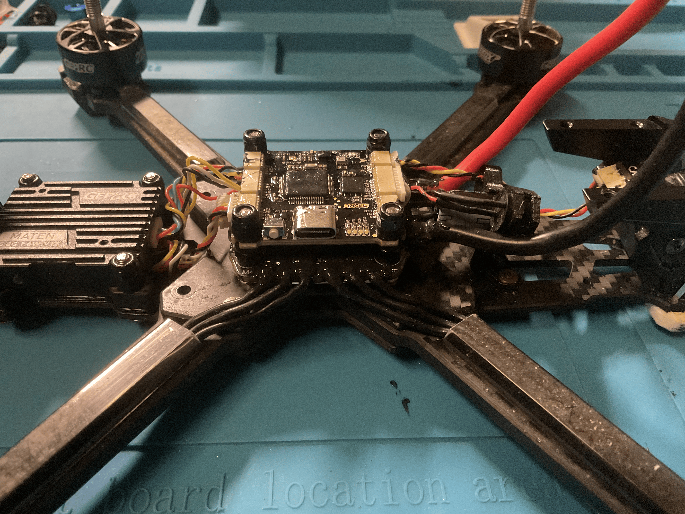

# waterproof-vapor-x5-drone

Modding stock analog BNF FPV Drone to be waterproof

Why Waterproof?
Drones usually short-circuit when exposed to moisture or water. By waterproofing this drone can survive impacts into deep snow and submersions into water. 

UPDATE 11/1/26:
Receiver was not connecting to controller. After tearing the drone back down found the 5v and GND wires were disconnected. Soldered and coated the wires back.

Before Coating:

What I Did:
1. Stripped the drone to the exposed frame and electronics
2. Cleaned all of the boards with 99% Isopropyl Alcohol.
3. Applied two layers of silicone conformal coating to each side of all of the boards.
4. To ensure durability, coated the high voltage wires (motor wires and main power lead pads) with liquid electrical tape.

After Coating:

Because this is a chemical waterproofing modification rather than a custom CAD or PCB design, there are no 3D designs or wiring diagram files. All modification step-by-step teardown, prep, and coating are documented fully through high-resolution photos located in the /photos folder of this repo.

Bill of Materials - Stock Vapor X5 Waterproofing Project:

Base Hardware (Drone used but any drone will do): 
Vapor X5 6S Analog Version FPV Drone (https://geprc.com/product/geprc-vapor-x5-analog-freestyle-fpv-drone/)

Preparation and Waterproofing Materials: 
Isopropyl Alcohol: Used for cleaning PCBs from flux and other grit (no more puretronics but https://www.microcenter.com/product/601362/mg-chemicals-isopropyl-alcohol-42-oz). 
Silicone Conformal Coating: For general waterproofing of all boards (https://newbeedrone.com/collections/all/products/newbeedrone-no-big-deal-conformal-coating). 
Liquid Electrical Tape: On high power joints to provide even more protection (https://www.aliexpress.us/item/3256807917032543.html?gatewayAdapt=glo2usa4itemAdapt).

Tools Used: 
Generic Hex screwdrivers 
Fine tip brush included in the conformal package
Generic Angled tweezers 
Generic Soft-bristled toothbrush 
Pinecil Soldering iron (https://pine64.com/product/pinecil-smart-mini-portable-soldering-iron/)
Generic Solder 
Generic Solder flux

Guide: 
/photos - pictures of the entire process.
/materials_used - everything used detailed.
